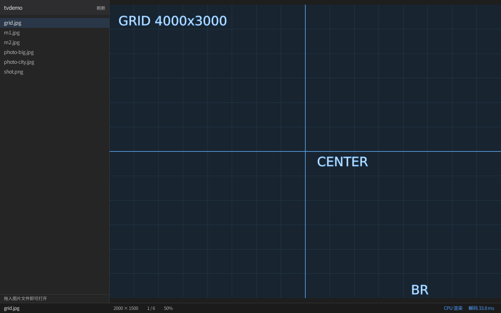

# TurboView CPU shell（策略 A：无 GPU 跨平台壳）

不依赖 GPU、不依赖 GPUI 的看图器外壳：一份代码，Windows（GDI/DXGI blit）、macOS（CoreGraphics）、Linux（X11/Wayland shm）共用同一套 CPU 合成路径。

当前进度：**第三阶段完成（性能改造 + Windows 真机验证）** —— 两级解码（视口首帧 + 后台高清替换）、平移快路径（移位拷贝 + 只重采样露出的条带）、Windows DPI 状态栏修正均已落地。



## 实测数据（Linux 容器，1280×800，纯 CPU，release）

### 解码（libjpeg-turbo，SIMD + 按显示尺寸缩放 IDCT）

| 输入 | 输出 | 耗时 |
|---|---|---|
| 4000×3000 JPEG（首帧，按视口 1000 px 走 1/4 IDCT） | 1000×750 | **20 ms** |
| 同图后台高清替换（上限 4096） | 4000×3000 | 60–75 ms（首帧已上屏，不阻塞） |
| 4000×3000 JPEG（复杂内容） | 2000×1500 | **73 ms** |
| 4000×3000 JPEG（低熵内容） | 2000×1500 | 34 ms |
| 1920×1080 JPEG | 1920×1080 | 23–27 ms |
| ZIP 内 1600×1200 JPEG | 1600×1200 | 23 ms |
| 4000×3000 + EXIF 方向 6 | 2000×1500 → 旋转 1500×2000 | 63 ms（含旋转） |

### 呈现与重采样（1000×774 视口）

| 操作 | 耗时 |
|---|---|
| 整窗合成（背景 + 图片 + 侧栏 + 状态栏） | **0.31 ms** |
| 合成 + 提交（softbuffer → X11 shm） | **1.05 ms** |
| 重建视口 + 合成 @100%（1:1 直拷） | **2.93 ms** |
| 重建视口 @200%（双线性放大） | 7.9 ms |
| 重建视口 @400% | 5.5 ms |
| **拖拽平移一帧 @400%（快路径）** | **1.98 ms** |
| 1:1 → fit 往返 | 4.1 / 4.8 ms |
| 打开 12 MP 照片到首帧上屏 | **约 33 ms**（首帧解码 20 + 首绘 12，高清后台补） |

> 平移走「上一帧移位拷贝 + 只重采样露出的四条边」，比重建整幅快 2–3 倍；旧机器按 2–4 倍折算仍然是 60 fps 以内的交互手感。

## 结构

```
cpu-shell/
├── src/decode.rs     libjpeg-turbo FFI（tjDecompress2 缩放档 1/1·1/2·1/4·1/8）
│                     + EXIF Orientation 解析与像素重排 + image crate 兜底（PNG/WebP/GIF…）
├── src/platform.rs   Platform trait：reveal / copy_text / register_default_viewer
│                     Linux(xdg-open) · macOS(open -R) · Windows(explorer /select)
├── src/docs.rs       目录扫描（std::fs，Windows 可换回 FindFirstFileExW 快路径）+ ZIP 浏览
├── src/viewer.rs     缩放锚点、平移、fit / 1:1、ROI 重采样（1:1 直拷 / 缩小 box / 放大双线性）
├── src/canvas.rs     RGBA 画布 + 裁剪 + blit
├── src/text.rs       fontdue 光栅 + 字形缓存（内置 Noto Sans SC 子集 2.3 MB）
├── src/ui.rs         侧栏 + 状态栏，全部带 clip
└── src/main.rs       winit 事件循环 + softbuffer 呈现 + 演示/基准钩子
```

## 三条性能规则（已落实）

1. **事件驱动**：只有输入/尺寸变化才重绘，静态看图 0 帧；
2. **局部重绘**：滚动只画侧栏，缩放只画图片区，状态栏变更才补状态栏；
3. **ROI 重采样**：只对视口覆盖到的源区域采样，4K 图放大到 800% 也不会整图重采样。

## 交互

| 输入 | 行为 |
|---|---|
| 滚轮 | 缩放，**锚定光标下的像素** |
| 左键拖拽 | 平移 |
| ← / → / 空格 | 上一张 / 下一张 |
| `+` / `-` | 放大 / 缩小 |
| `0` / `1` | fit / 1:1 |
| F11 | 全屏（Esc 退出） |
| `e` | 在文件管理器中定位 |
| `c` | 复制路径 |
| `r` | 重新扫描当前目录 |
| 拖放文件/目录/ZIP | 直接打开 |

启动参数 `turboview-cpu <file|dir|zip>`；侧栏点击切换图片。

## 复用情况（相对 0.20 旧代码）

| 旧模块 | 处理 |
|---|---|
| `turbo.rs` | 解码主体逻辑（缩放档选择、tjDecompress2 调用约定、EXIF 方向）直接沿用；只去掉 `#[link]` 与 `read_file_sequential` 两处 Windows 缝 |
| `archive.rs` | ZIP 部分已接入（zip crate），7z/rar 待接 |
| `dirtree.rs` | 树模型可复用于后续侧栏目录树，当前先用平铺列表 |
| `scanner.rs` | 排序/过滤逻辑保留，枚举层换 std::fs |
| `win32.rs` | 对应拆进 `platform.rs`，Windows 实现待搬注册表关联 |
| `main.rs` | 视图层重写；缩放锚点、缓存策略等逻辑在新 `viewer.rs` 里重建 |

## 构建

先构建仓库自带的 libjpeg-turbo 静态库，再编 crate：

```bash
# Linux
cmake -S . -B build-turbo-linux -DCMAKE_BUILD_TYPE=Release \
      -DWITH_SIMD=ON -DWITH_TURBOJPEG=ON -DENABLE_SHARED=OFF -DENABLE_STATIC=ON \
      -DWITH_TOOLS=OFF -DWITH_TESTS=OFF -DWITH_JAVA=OFF -DWITH_FUZZ=OFF
cmake --build build-turbo-linux --target turbojpeg-static -j

# Windows（MSVC + Ninja，与仓库 CI 相同参数）
cmake -G Ninja -S . -B build-turbo -DCMAKE_BUILD_TYPE=Release `
      -DWITH_SIMD=ON -DWITH_TURBOJPEG=ON -DENABLE_SHARED=OFF -DENABLE_STATIC=ON `
      -DWITH_CRT_DLL=ON -DWITH_TOOLS=OFF -DWITH_TESTS=OFF -DWITH_JAVA=OFF -DWITH_FUZZ=OFF
cmake --build build-turbo --target turbojpeg-static
cd cpu-shell && cargo build --release

# Windows（从 Linux 交叉编译，仅用于编译校验，无 SIMD）
cmake -S . -B build-turbo-mingw -DCMAKE_SYSTEM_NAME=Windows `
      -DCMAKE_C_COMPILER=x86_64-w64-mingw32-gcc -DWITH_SIMD=OFF ...
cargo build --release --target x86_64-pc-windows-gnu
```

`build.rs` 按目标选择 `build-turbo/turbojpeg-static.lib`（MSVC）、`build-turbo-mingw/libturbojpeg.a`（mingw）或 `build-turbo-linux/libturbojpeg.a`（Linux）。

Linux 系统依赖：`libx11-dev libx11-xcb-dev`（winit/softbuffer 后端）。

## 平台状态

| 平台 | 编译 | 运行验证 |
|---|---|---|
| Linux | ✅ | ✅ 截图 + 基准 + **17 项单测**（含平移快路径像素一致性） |
| Windows 10（19045，真机）/ 11 | ✅ 交叉编译通过（PE32+ GUI，6.3 MB） | ✅ 真机跑通：首帧 / fit / 4× / 平移 / 1:1 / 翻页 / ZIP 全流程截图 |
| macOS | 未验证 | 未验证 |

Windows 构建产物为 GUI 子系统（`windows_subsystem = "windows"`，release），双击不弹控制台；`TV_DEMO` 等调试输出需在终端里启动才会显示。

## 测试钩子

```bash
TV_OPEN=photo.jpg TV_DUMP=/tmp/frame.png ./turboview-cpu        # 单帧截图
TV_OPEN=photo.jpg TV_DEMO=1 TV_BENCH=1 TV_DUMP_DIR=/tmp/dump \
  xvfb-run -a --server-args="-screen 0 1280x800x24" ./turboview-cpu
```

`TV_DEMO` 依次执行 fit → 2× → 4× → 平移 → 1:1 → fit → 下一张，每步导出截图并打印耗时。

## 下一步

1. GitHub Actions `windows-latest` 跑通（编译 + 15 项单测 + 无头窗口冒烟）；
2. macOS 侧验证：`open -R`、Retina 2×；
3. 侧栏从平铺列表升级为目录树（复用 `dirtree.rs` 模型），加缩略图与预取；
4. 7z/rar 支持（原 `archive.rs` 已有实现）；
5. 大图换 ROI 解码：放大超过 200% 时按视口回源解码，而不是放大已解码图。

## 已知取舍

- 无输入法、无无障碍、无多窗口——看图场景有意省略；
- 图片区整块重绘 + 平移走快路径：只有缩放/换图才重采样整幅，纯平移时只补边缘条带（快路径与整幅重采样有单测保证像素一致）；
- 高 DPI 下按 scale factor 放大布局，Retina 像素量 4 倍，整窗合成仍在 1.5 ms 量级。
